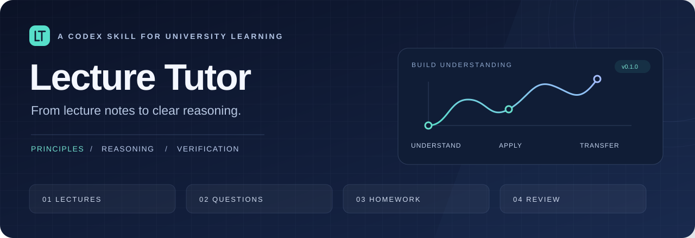

<p align="center">
  
</p>

<p align="center">
  <strong>把课件讲透，把思路讲清。</strong><br>
  面向大学课程的 Codex Skill · 讲课 / 答疑 / 作业 / 复习
</p>

<p align="center">
  <a href="#快速开始">快速开始</a> ·
  <a href="使用与维护.md">安装与使用</a> ·
  <a href="validation/trial-001/lecture.md">查看试讲</a> ·
  <a href="validation/验证报告.md">验证记录</a> ·
  <a href="https://github.com/StarAnny/lecture-tutor/releases/latest">下载技能包</a>
</p>

---

Lecture Tutor 将课程材料转化为有依据的讲解、推导和练习。以争取 A+ 为学习目标，结合评分要求和实际薄弱点安排学习，同时训练抓住问题核心、检查假设和从原理出发解决问题的能力。

## 快速开始

将 [`lecture-tutor`](lecture-tutor) 文件夹安装到个人技能目录，重开聊天后附上课件，输入：

```text
$lecture-tutor 假如你是大学老师，请详细讲一下这节课。
```

第一次使用？跟随 [安装与使用说明](使用与维护.md) 即可。技能本身无需 API key、额外账号或运行教学脚本；文件读取由所在的 Codex 环境提供。

## 四种学习方式

| 学习目标 | 可以这样问 | 你会得到什么 |
| --- | --- | --- |
| **讲懂一节课** | “从基础开始讲这份课件。” | 知识主线、重要概念、关键推导与代表性例题 |
| **解决一个卡点** | “这一步为什么成立？” | 围绕疑问的解释、成立条件与必要反例 |
| **做好一道作业** | “先提示我” / “给完整推导” / “检查我的解法” | 与请求相符的帮助深度，以及结果检查 |
| **准备一次考核** | “按评分标准安排三天复习，先给自测题。” | 有依据的优先级、可执行安排和针对性练习 |

## 思考能力如何体现在教学中

**抓住核心**：先明确未知量和约束，识别真正决定答案的条件，再解释为什么选择某种方法。

**检验结论**：区分事实、假设和推测，检查关键一步的依据，用反例或条件变化寻找适用边界。

**建立与验证模型**：对适合的理工科问题，从基本原理建模，选择量纲、数量级、初值、极限或代回检查结果。

这些方法会融入当前问题，讲解深度随任务调整；用户可以随时要求更简洁、更详细、只给提示或直接给完整答案。

## 先看实际答复

本项目保留了一组自编 RC 电路材料及独立试用答复，便于直接评估教学方式。

| 想看什么 | 示例 |
| --- | --- |
| 一节课能讲到什么程度 | [从建模讲到传递函数](validation/trial-001/lecture.md) |
| 单点答疑会不会展开太多 | [非零初值与传递函数](validation/trial-001/formula.md) |
| 提示和完整解答有何区别 | [提示](validation/trial-001/hint.md) · [完整解答](validation/trial-001/solution.md) |
| 能否找出学生最早出错的位置 | [检查作业](validation/trial-001/check_work.md) |
| 怎样安排复习与自测 | [三天复习示例](validation/trial-001/review.md) |

## 验证情况

**10 个代表性场景已通过本次人工内容复核**，包含整课讲解、公式答疑、提示、完整解答、作业检查、参数缺失、复习、无关请求、材料缺失和部分内容不可读。

结构检查、输入、原始答复与数值基准都保存在 [`validation`](validation) 中。样例集中在电路课文字讲义；真实 PDF/PPT 解析、其他学科和长期学习效果仍需更多实际使用验证。详见 [验证报告](validation/验证报告.md)。

## 项目结构

```text
lecture-tutor/
├── SKILL.md                  触发范围与共用教学规则
├── agents/openai.yaml        技能列表中的名称和介绍
└── references/
    ├── teaching.md           整课教学
    ├── problem-solving.md    答疑与作业指导
    └── review.md             复习与反馈

docs/                        项目封面与版本说明
validation/                  自编样本、试用答复与核对记录
scripts/release.py            项目检查与可复现打包
```

## 维护与打包

技能规则和说明均为可编辑文本。用“原请求 → 实际答复 → 期望改进”记录反馈，修改对应细则后复用相关样例检查行为。

Python 3.10+ 下可检查项目并生成只包含技能文件的发布包：

```powershell
python scripts/release.py --check
python scripts/release.py
```

输出位于 `dist/`，包括带版本号的 ZIP 和 SHA-256 校验文件。打包工具只使用 Python 标准库。[版本记录](CHANGELOG.md)
